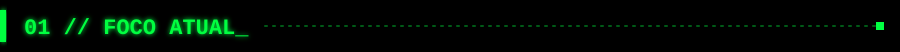
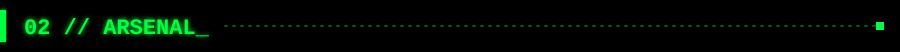
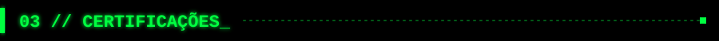
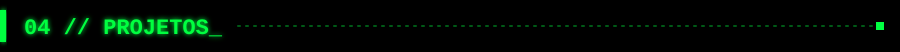
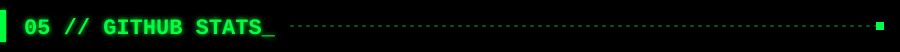
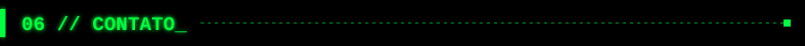

  

 

<i>Quem conhece a rede por dentro sabe onde ela quebra. Uno a base de infraestrutura e telecom com a mentalidade analítica da segurança ofensiva e defensiva.</i>

<table width="100%">
<tr>
<td width="50%" valign="top"><b>🎓 Pós-graduação</b> Cibersegurança Ofensiva na Acadi-TI, cobrindo Red, Blue e Green Team.</td>
<td width="50%" valign="top"><b>🧪 Hacking Ético</b> Hacking Ético (IBSEC) e Introdução à Cibersegurança (Cisco).</td>
</tr>
<tr>
<td width="50%" valign="top"><b>🏴‍☠️ Laboratórios práticos</b> Pentest e análise de vulnerabilidades em ambientes controlados.</td>
<td width="50%" valign="top"><b>📜 Certificações</b> Preparação para Security+, CEH, CNSE, CSAE e CPTE.</td>
</tr>
</table>

<b>🎯 Alvo:</b> Analista de Cibersegurança &nbsp;•&nbsp; Analista de SOC &nbsp;•&nbsp; Pentester &nbsp;•&nbsp; Analista de Redes e Segurança

<table width="100%">
<tr>
<th width="33%">🔴 Red Team</th>
<th width="33%">🔵 Blue Team</th>
<th width="33%">🌐 Redes & Infra</th>
</tr>
<tr>
<td valign="top" align="center">Pentest Análise de Vulnerabilidades Hacking Ético Enumeração & Recon</td>
<td valign="top" align="center">Resposta a Incidentes Monitoramento / SOC Hardening Auditoria de Redes</td>
<td valign="top" align="center">Roteamento & Switching Firewall & Proxy ACL & Controle de Acesso Telecom & Wireless</td>
</tr>
</table>
 

  

<table width="100%">
<tr>
<td align="center"> em preparação</td>
<td align="center"> em preparação</td>
<td align="center"> em preparação</td>
<td align="center"> em preparação</td>
<td align="center"> em preparação</td>
</tr>
</table>

<pre>
drwxr-xr-x  homelab-pentest/      # laboratório de pentest (em construção)
drwxr-xr-x  ctf-writeups/         # writeups de CTFs (TryHackMe / HackTheBox)
drwxr-xr-x  security-scripts/     # automação e recon
drwxr-xr-x  network-hardening/    # boas práticas de hardening em redes
</pre>

🚧 Repositórios sendo adicionados continuamente. Acompanhe o perfil.

<!-- Quando criar os perfis, descomente e ajuste os links:

-->
  
<code>root@lucas:~$ echo "Aberto a oportunidades em Cibersegurança: presencial, híbrido ou remoto"</code>
  

